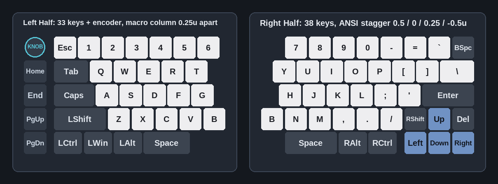
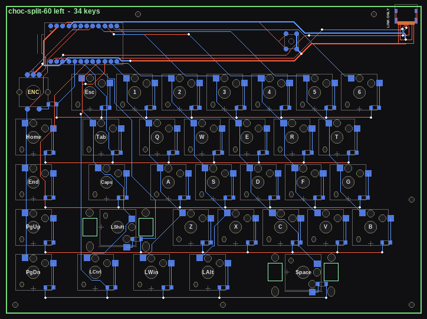
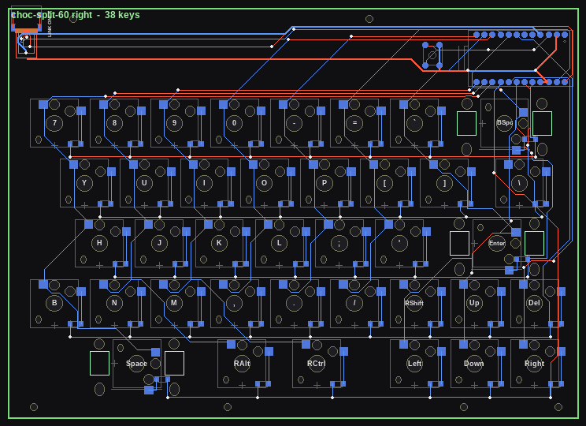
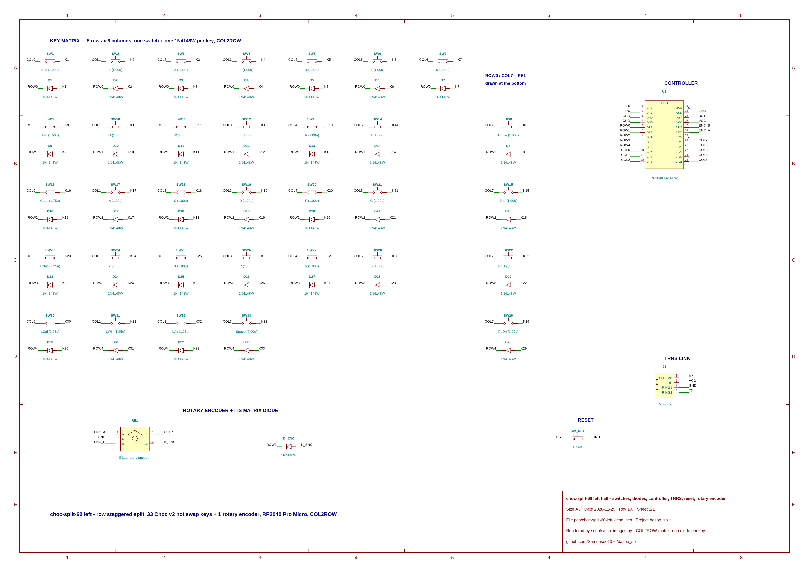
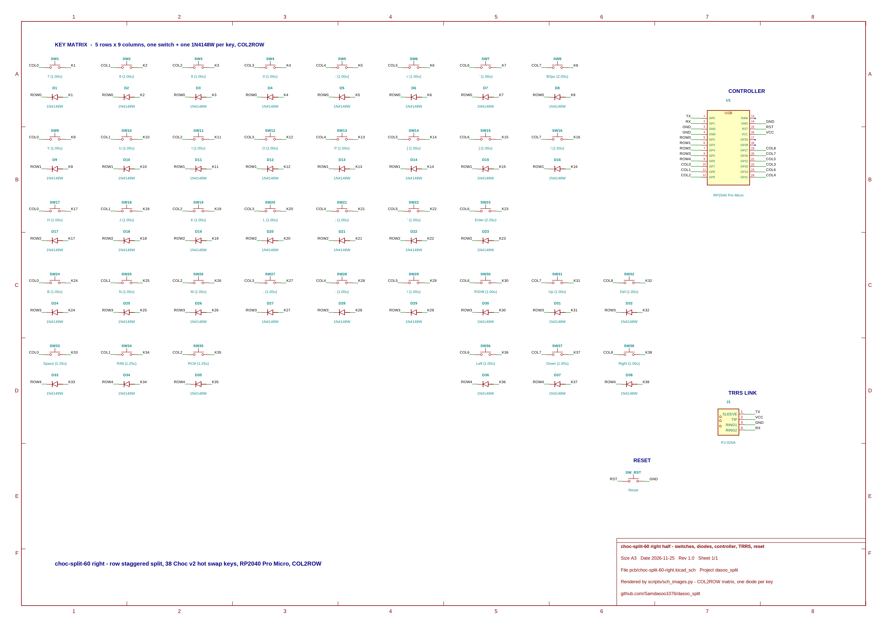

# choc-split-60 ⌨️

로우스태거(row‑staggered) 배열을 좌우로 나눈 **스플릿 키보드**입니다.
Kailh **Choc v2(CPG1353) 로우프로파일 핫스왑** 스위치 **71개 + 로터리 인코더 1개 = 72키 포지션**
(좌 34 / 우 38), 좌우 각각 **RP2040 Pro Micro**, 안쪽 상단의 **USB-C 링크 포트**로 좌우를 잇고,
`COL2ROW` 매트릭스를 씁니다.
모든 PCB 배선은 자동 라우터 없이 좌표를 계산해 직접 배선했고, `scripts/verify_pcb.py`로 전수 검증합니다.


*(실물 느낌 렌더 — 위 도면 그대로의 배열입니다)*



*(KLE 형식 도면 — 좌우 행 오프셋과 0.25u 매크로 열 간격이 그대로 보입니다)*




*(PCB 미리보기: 빨강 = F.Cu, 파랑 = B.Cu, 흰 점 = 비아, 회색 = F.Silkscreen)*



*(좌 하프 회로도 — 스위치 33 + 다이오드 33, 컨트롤러 U1, USB-C 링크 J1, 리셋, EC11 인코더 RE1과 그 다이오드.
각 칸이 매트릭스의 (행, 열) 자리이고, 넷 이름이 그대로 적혀 있습니다)*



*(우 하프 회로도 — 스위치 38 + 다이오드 38, 컨트롤러·USB-C 링크·리셋. 아래쪽 두 줄의 `← ↓ →` 가 매트릭스
COL6·7·8 에 그대로 놓입니다)*

---

## 1. 보드 사양

| 항목 | 값 |
|---|---|
| 배열 | 65% 로우스태거 + 좌측 매크로 열 + 우측 방향키·Del, 좌우 분리 |
| 키 수 | 좌 33 스위치 + 인코더 1 / 우 38 스위치 = **스위치 71 + 엔코더 1 (72 포지션)** |
| 키 피치 | 19.05 mm (MX 표준 피치, Choc v2 스위치 + MX 호환 키캡) |
| 행 스태거 | 좌 `0 / 0.5u / 0.75u / 1.25u` · 우 `-0.5 / 0 / 0.25 / -0.5u` (Tab 1.5u·Caps 1.75u·LShift 2.25u·`\` 1.5u·RShift **1u**) |
| 분할 위치 | 숫자열 `6`\|`7`, 알파열 `T`\|`Y`, `G`\|`H` — 하단 알파열은 `B` 가 **양쪽 하프에 하나씩** 있습니다(아래 설명) |
| 매크로 열 | 좌측 최외곽 열에서 **0.25u(4.7625 mm)** 띄워 배치, 위→아래 `노브 → Home → End → PgUp → PgDn` |
| 방향키 | `RShift`(1u) 바로 오른쪽 `↑`, 그 아래 `↓`, `↑` 오른쪽에 `Del`, `Del`/`↓` 아래에 `→`, 그 왼쪽 `←`. `RCtrl` 과 `←` 사이는 **0.5u 빈칸**(예전 `RFn` 자리) |
| 스태빌라이저 | **2u 이상 키 5개**에 **Choc v2 PCB 마운트 스태빌**(Salicylic‑acid3 / Keeb‑On! 스크류 타입) — 좌 `LShift`(2.25u)·`Space`(2u) / 우 `BSpc`(2u)·`Enter`(2.25u)·`Space`(2.25u). 키마다 타원 홀 4개(3.2×3.4 / 3.0×4.0 mm, 중심에서 좌우 ±11.9 mm) + 하우징이 지나가는 **Edge.Cuts 컷아웃 2개**(x 8.9~14.9, y ±3.75 mm) = 홀 20 + 컷아웃 10 |
| 스위치 | Kailh Choc v2 (CPG1353), **핫스왑 소켓** (`SW_Hotswap_Kailh_Choc_V2`) — **Choc v1 스위치는 장착 불가**(v1 가이드 페그 홀 제거, v2는 중심 홀 Ø5.0 + 가이드 포스트 1개) |
| 인코더 | Alps EC11 / Bourns PEC11R 호환 5핀 (A·C·B + 푸시 스위치 2핀), 6 mm 축 |
| 다이오드 | 1N4148W SOD-123 × 72 (스위치 71 + 인코더 푸시 1), `COL2ROW` |
| MCU | RP2040 Pro Micro (Elite‑Pi / Pro Micro RP2040 호환, 24핀) × 2 |
| 좌우 연결 | **USB-C 16핀 리셉터클 × 2** (HRO TYPE‑C‑31‑M‑12 규격), 각 하프 **안쪽 상단**에서 케이블이 **위로** 꽂힘. Full‑duplex UART (`VBUS=VCC` / `GND` / `D+=TX` / `D-=RX`, 좌우는 서로 교차) — **링크 전용**, PC에 꽂는 포트 아님 |
| 리셋 | 6×6 택트 스위치 × 2 (RST–GND) |
| PCB | 2층, 1.6 mm, 좌 176×130 mm / 우 181×130 mm, M2 마운팅 홀 각 6개 |
| 펌웨어 | QMK + VIAL (RP2040, `MASTER_LEFT`, `ENCODER_MAP_ENABLE`) |

### 레이아웃

```
       ┌───┐
       │ENC│   ┌───┬───┬───┬───┬───┬───┬───┐
       ├───┤   │Esc│ 1 │ 2 │ 3 │ 4 │ 5 │ 6 │
       │Hom│   ├───┴─┬─┴─┬─┴─┬─┴─┬─┴─┬─┴─┬─┘
       ├───┤   │ Tab │ Q │ W │ E │ R │ T │
       │End│   ├─────┴┬──┴┬──┴┬──┴┬──┴┬──┘
       ├───┤   │ Caps │ A │ S │ D │ F │ G │
       │PgU│   ├──────┴┬──┴┬──┴┬──┴┬──┴┬──┘
       ├───┤   │ LShift│ Z │ X │ C │ V │ B │
       │PgD│   ├───┬───┼───┼──┬┴───┴───┘
       └───┘   │Ctl│Win│Alt│ ␣ Space │      ← 좌측 (34 포지션, Alt 옆 0.5u 빈칸)
               └───┴───┴───┴──┴────────┘
                ↑ 매크로 열과 본열 사이 간격 0.25u
```

우측 하프 (38 포지션). 각 행은 왼쪽 끝이 자기 오프셋에서 시작합니다 — x는 키 단위(u).

| 행 | 시작 x | 키 (왼쪽→오른쪽) | 오른쪽 끝 |
|---|---|---|---|
| Row 0 | **-0.5u** | `7 8 9 0 - =` + `` ` `` + `BSpc` **2.0u** | 8.5u |
| Row 1 | **0.0u** | `Y U I O P [ ]` + `\` 1.5u | 8.5u |
| Row 2 | **0.25u** | `H J K L ; '` + `Enter` 2.25u | 8.5u |
| Row 3 | **-0.5u** | `B` + `N M , . /` + `RShift` 1.0u + `Up` + `Del` | 8.5u |
| Row 4 | **0.25u** | `Space` 2.25u + `RAlt`/`RCtrl` 1.25u×2 + **0.5u 빈칸** + `Left`/`Down`/`Right` | 8.5u |

다섯 행 모두 오른쪽 끝이 **8.5u** 한 줄로 맞습니다 — `BSpc` · `\` · `Enter` · `Del` · `Right` 가 같은 세로선에서 끝납니다.
Row 4 를 0.25u 왼쪽으로 당겨서 맞춘 것이라, `Left`/`Down`/`Right` 는 각각 `RShift`/`Up`/`Del` **바로 아래**에 놓입니다.
`RCtrl`(3.75~5.0u)과 `Left`(5.5u) 사이의 **0.5u 빈칸**은 전에 `RFn` 이 있던 자리입니다.
좌측 하프의 행 오프셋(`0 / 0.5 / 0.75 / 1.25u`)은 ANSI 그대로이고, 우측 하프도 자기 안에서는
ANSI 스태거(`T`|`Y`, `G`|`H`, `B`|`N`)를 그대로 가집니다. 다만 **숫자열은 ANSI보다 1u 왼쪽**에서
시작합니다 — 2u 백스페이스를 지키려고 행을 왼쪽으로 옮겼기 때문입니다. 그래서 두 하프를
숫자열(`6`|`7`)에 맞춰 붙이면 알파열은 1u 벌어지고, 알파열에 맞춰 붙이면 숫자열이 1u 겹칩니다
(서로 다른 두 장이라 겹쳐 놓을 수는 없으니 실제로는 숫자열 기준으로 붙이게 됩니다).

> 하단 알파열은 ANSI 분할선이 `B`|`N` 이라 `B` 가 원래 좌측 하프 끝에 있습니다.
> 이 보드는 **우측 하프 Row 3 왼쪽 끝(x = -0.5u)에도 `B` 를 하나 더** 두었습니다
> (요청에 따라 추가). 그래서 `B` 키는 두 장에 하나씩, 펌웨어에서도 `L35`·`R80` 두 자리가 모두 `KC_B` 입니다.
> 한쪽 `B` 가 필요 없으면 키맵에서 그 자리를 `KC_NO` 로 바꾸면 됩니다.

> 숫자열 `BSpc` 는 **2u 그대로**이고, 그 왼쪽에 **1u `` ` ``** 가 있습니다(요청). 2u 를 지키려고
> 숫자열 전체를 1u 왼쪽으로 옮겼기 때문에 `7` 은 `B` 바로 위, `8` 은 `N` 바로 위에 옵니다.
> 백틱은 우측 하프에만 있고, 좌측 하프의 맨 왼쪽 키는 **`Esc`** 입니다(원래 `` ` `` 자리).

키캡 구성: **1u × 58, 1.25u × 5, 1.5u × 2, 1.75u × 1, 2u × 2, 2.25u × 3** (총 71개) + 노브 1개

---

## 2. 매트릭스와 핀맵

양쪽 PCB 모두 **5행 × 9열** 매트릭스를 쓰고, MCU 핀 배치는 좌우가 완전히 동일합니다.
좌측 매크로 열은 **COL7** 을 쓰고, 인코더 푸시 스위치는 그 열의 Row 0(`L07`)에 들어갑니다.
우측 하프는 `B N M , . / RShift Up Del` 로 9개 키가 필요해 **COL0~COL8** 을 모두 씁니다
(좌측은 COL8이 비어 있습니다).

### MCU 핀 → 네트 (좌/우 동일)

| 핀 | 이름 | 네트 | | 핀 | 이름 | 네트 |
|---|---|---|---|---|---|---|
| 1 | GP0 | `TX` | | 13 | RAW | – (미사용) |
| 2 | GP1 | `RX` | | 14 | GND | `GND` |
| 3 | GND | `GND` | | 15 | RST | `RST` (리셋 스위치) |
| 4 | GND | `GND` | | 16 | VCC | `VCC` (USB-C VBUS) |
| 5 | GP2 | `ROW0` | | 17 | GP29 | `ENC_B` (좌측만) |
| 6 | GP3 | `ROW1` | | 18 | GP28 | `ENC_A` (좌측만) |
| 7 | GP4 | `ROW2` | | 19 | GP27 | `COL8` (우측만) |
| 8 | GP5 | `ROW3` | | 20 | GP26 | `COL7` |
| 9 | GP6 | `ROW4` | | 21 | GP22 | `COL5` |
| 10 | GP7 | `COL0` | | 22 | GP20 | `COL3` |
| 11 | GP8 | `COL1` | | 23 | GP23 | `COL6` |
| 12 | GP9 | `COL2` | | 24 | GP21 | `COL4` |

> 열 순서를 한 줄로 정리하면 `COL0..COL8 = GP7, GP8, GP9, GP20, GP21, GP22, GP23, GP26, GP27` 입니다.
> 우측 PCB는 인코더가 없어서 GP28/GP29가 비어 있고, 그 핀은 풀업 입력으로만 남습니다.
> 좌측 PCB의 `COL8`(GP27)은 키가 없어서 풀업 입력으로만 남습니다.
> 이번 개정에서 예비로 두었던 **GP27을 COL8** 에 배정해 9열을 수용했습니다.

### 키 → (행, 열)

| 행 \ 열 | 0 | 1 | 2 | 3 | 4 | 5 | 6 | 7 | 8 |
|---|---|---|---|---|---|---|---|---|---|
| L0 | 좌 Esc | 1 | 2 | 3 | 4 | 5 | 6 | 좌 ENC | – |
| L1 | 좌 Tab | Q | W | E | R | T | – | 좌 Home | – |
| L2 | 좌 Caps | A | S | D | F | G | – | 좌 End | – |
| L3 | 좌 LShift | Z | X | C | V | B | – | 좌 PgUp | – |
| L4 | 좌 LCtrl | LWin | LAlt | 좌 Space | – | – | – | 좌 PgDn | – |
| R0 | 우 7 | 8 | 9 | 0 | - | = | `` ` `` | BSpc | – |
| R1 | Y | U | I | O | P | [ | ] | \ | – |
| R2 | H | J | K | L | ; | ' | Enter | – | – |
| R3 | 우 B | N | M | , | . | / | RShift | ↑ | Del |
| R4 | 우 Space | RAlt | RCtrl | – | – | – | ← | ↓ | → |

* QMK `MATRIX_ROWS = 10` (좌 0–4 / 우 5–9), `MATRIX_COLS = 9`.
* `R4` 의 3~5열은 비어 있고, `← ↓ →` 는 각각 `RShift`·`↑`·`Del` 과 같은 열(6·7·8)에 들어갑니다.
* 인코더 A/B는 매트릭스가 아니라 **GP28 / GP29** 직결이고, 푸시 스위치만 매트릭스 `L07`에 들어갑니다.

### USB-C 링크 배선 (좌우가 서로 반대)

| USB-C 핀 | 좌측 PCB | 우측 PCB |
|---|---|---|
| VBUS (A4·B4·A9·B9) | `VCC` | `VCC` |
| GND (A1·B1·A12·B12) + 쉴드 4핀 | `GND` | `GND` |
| D+ (A6·B6) | `TX` (GP0) | `RX` (GP1) |
| D- (A7·B7) | `RX` (GP1) | `TX` (GP0) |
| CC1·CC2·SBU1·SBU2 (A5·B5·A8·B8) | – (미연결) | – (미연결) |

> 케이블은 그대로 지나가므로 UART 한 쌍은 **PCB에서 교차**시킵니다. 좌측이 항상 마스터이고
> (`MASTER_LEFT`) USB‑C 케이블은 **좌측**에 꽂습니다.

> **링크 전용(LINK ONLY)**: 이 포트는 좌우를 잇는 5V/GND/D+/D- 전용입니다. 보드 실크에도
> `LINK ONLY` 를 넣었습니다. PC에 꽂으면 5V가 VCC로 역류하고 D+/D-가 PC의 USB 데이터선에 붙습니다.

> **5.1k CC 풀다운은 달지 않았습니다.** ① 이 포트는 장치(PC)와 협상하는 포트가 아니라 두 하프 사이의
> 직결 링크이고, VBUS는 VCC에 그대로 연결돼 있어 C-to-C 케이블로도 5V가 그대로 전달됩니다.
> ② CC를 비워 두면 **C-to-C로 PC에 꽂았을 때 PC가 VBUS를 올려 주지 않으므로**(CC 검출 실패) 역급전이
> 한 겹 막아집니다. ③ 반대로 CC 풀다운을 달면 PC가 이 보드를 장치로 인식해 VBUS를 올리므로 링크
> 포트에 PC를 꽂았을 때 위험해집니다. ④ A-to-C 케이블은 CC와 무관하게 5V가 나오므로 **절대 금지**입니다.
> 나중에 이 포트를 진짜 USB 장치 포트로 쓰려면 CC1·CC2에 5.1k를 GND로 달고 펌웨어를 바꿔야 합니다.

---

## 3. 배선 설계 규칙 (자동 라우터 미사용)

* 행(Row) 버스는 **F.Cu에 가로**로, 열(Col)은 **B.Cu에 세로**로 배선하고, 두 방향이 교차하는 지점은
  비아로 층을 바꿔 같은 층 쇼트를 만들지 않습니다.
* 행 버스는 **키 중심 +10.69 mm에서 한 줄로 곧게** 지나갑니다. 이 높이는 이 행 2u 이상 키의
  앞쪽 타원 홀(아래 끝 `+10.24`)과 바로 아랫줄 2u 이상 키의 뒤쪽 타원 홀(위 끝 `+11.15`) 사이
  0.91 mm 통로의 한가운데라, **홀을 돌아가는 우회 구간이 하나도 없습니다**(양쪽 홀까지 구리 0.325 mm).
* 그 통로는 0.91 mm뿐이라 0.6 mm 비아가 통과할 수 없습니다. 비아 열이 홀 바로 아래에 걸리는 두 곳
  (우측 `]`·`\`)만 비아를 버스 선 위에서 1.87 mm 옆으로 밀고 캐소드가 45도로 한 번 꺾여 들어가며,
  나머지 69개는 캐소드 패드에서 수직으로 바로 내려옵니다.
* 스태빌 타원 홀 20개는 **양면 기판 관통 NPTH**로, 라우터가 트랙·비아를 놓을 때 장애물로 계산합니다
  (스위치 홀·핫스왑 패드·다이오드·마운팅 홀·USB-C/리셋/인코더 패드와 같은 취급).
* 스태빌 **컷아웃 10개(Edge.Cuts 사각 6×7.5 mm)** 는 보드에서 잘려 나가는 영역이라, 라우터가
  트랙·비아를 놓을 때 사각형을 0.70 mm 부풀려 통행 금지 구역으로 잡습니다(실제 구리 이격 0.55 mm 이상 — KiCad 기본 동박-모서리 규칙 0.5 mm도 만족).
* **2u 이상 키의 스위치는 90도 돌려 배치**했습니다. 핫스왑 소켓 패드가 정렬된 채로는 소켓 패드
  2번(x +8.5)이 오른쪽 컷아웃(x 8.9~14.9) 모서리를 파고들고, 소켓 몸체도 스태빌 하우징의 뒤쪽
  돌출부와 부딪힙니다(제작자 Salicylic‑acid3도 "스위치를 옆으로 돌리라"고 안내). 90도 회전 시
  소켓 패드는 x −7.3~+7.3 안에 들어와 컷아웃과 0.2 mm 이상 떨어집니다.
* 다이오드는 스위치 중심에서 **x +6.75 / y +6.5 mm**(일반 키)에 두고, 회전한 2u 키와 인코더는
  **거울 배치(캐소드가 오른쪽)** 로 x **+8.04 / y +5.0 mm** 에 둡니다. 회전 키는 소켓 다리 홀
  (3.05 mm, x +3.81)과 앞쪽 타원 홀(x +10.4) 사이 5.06 mm 틈에 들어가야 해서, 애노드 패드를
  다리 홀에서 0.3 mm, 캐소드 패드를 타원 홀에서 0.31 mm 띄운 자리입니다. 그래서 다이오드와
  **아랫줄 핫스왑 소켓 패드 사이가 2.05 mm → 4.55 mm** 로 벌어졌습니다(SOD-123 몸체와 소켓
  몸체가 조립할 때 서로 부딪히지 않을 여유).
* 다이오드 캐소드의 비아는 **패드 위가 아니라** 패드에서 0.45 mm 아래, 행 버스 선 위에 놓고
  짧은 트랙으로 잇습니다. **패드 위 비아(via-on-pad) 0개** — 비아에서 가장 가까운 패드·홀까지
  0.642 mm 입니다.
* 신호선 **0.25 mm**, 전원(VCC/GND) **0.5 mm**, 비아 **0.6 / 0.3 mm(드릴)**.
* 동일 층 타 네트 교차 0건, 최소 클리어런스 **0.2 mm**, 보드 외곽 이격 **0.3 mm**.
* 모든 트랙은 0/45/90도. 스위치 홀·핫스왑 패드·마운팅 홀·USB-C/리셋/인코더 패드를 장애물로 계산해 회피.
* **USB-C 링크 포트의 0.5 mm 피치 16핀**은 좌표를 직접 계산해 손으로 빼냈습니다. 패드 사이
  (0.5 − 0.3 = 0.2 mm)로는 0.25 mm 트랙도 비아도 지나갈 수 없어, 패드마다 **보드 안쪽으로 직선으로**
  빠져나온 뒤 패드 줄 뒤에서 갈라집니다. D+ (A6/B6)는 A6이 가운데라 이웃 D- 두 줄에 막히므로, B7·A7을 45도로
  바깥으로 벌린 다음 A6 비아를 그 위에 놓고 **B.Cu로 건너가** B6 비아와 잇습니다(0.6 mm 비아가
  0.25 mm 트랙 옆에 서려면 0.625 mm가 필요). VBUS 두 패드는 +3.0 mm에서 F.Cu로 합쳐 비아 하나로
  B.Cu로 내리고, GND는 두 패드와 **쉴드 다리 4개**를 모두 F.Cu로 묶었습니다(쉴드 다리는 패드 줄
  **앞쪽**, 즉 보드 끝 쪽에 있어 좌우 한 줄씩 세로로 이어 GND 패드에 붙였습니다). 나머지 4핀(CC/SBU)은
  미연결입니다.
* 매크로 열 스위치도 나머지 키와 같은 트러스(스위치 → 다이오드 → 비아 → 행 버스)를 그대로 씁니다.
  인코더 푸시 스위치는 `S2 → D_ENC → ROW0` 로 짧게 90도 두 마디로 연결합니다.
* 양면 **GND 존**(F.Cu, B.Cu) + GND는 별도 트랙으로도 전부 연결(존 필 없이도 통전).
* `Edge.Cuts`는 폐곡선(4개 선분)으로 마감, 키·부품과 0.3 mm 이상 이격.

---

## 4. 검증 결과

`scripts/verify_pcb.py`가 생성된 `.kicad_pcb` 파일을 **독립적으로 파싱**해 다음을 전수 검사합니다.

1. 모든 신호 네트 100% 연결(미연결 패드 0건)
2. 동일 층 타 네트 클리어런스 위반 0건 (정확한 폴리곤–세그먼트 거리 계산)
   — **패드에 다른 네트 트랙이 닿는 단락을 따로 보고하는 `check_pad_track()` 포함**
3. 스위치–다이오드 1:1 매칭, 극성(캐소드→행, 애노드→스위치) 일치
4. `Edge.Cuts` 폐곡선 및 외곽 이격
5. 트랙 0/45/90도, 최소 폭, GND 존 존재
6. **2u 이상 스위치마다 Choc v2 스태빌 타원 홀 4개(3.2×3.4 / 3.0×4.0 mm, ±11.9 mm)가
   정확한 위치에 있는지**, v2 가이드 포스트 홀(1.8×2.2 mm 슬롯, 회전 각도 반영)이 있고
   **v1 페그 홀(Ø1.9, ±5.5)이 남아 있지 않은지**, 그리고 그 홀에서 어떤 구리도 0.3 mm 안에
   들어오지 않는지
7. **스태빌 컷아웃 10개가 각각 닫힌 사각 루프이고 보드 안쪽에 있으며, 구리와 0.3 mm 이상
   떨어져 있는지**
8. **패드 위 비아(via-on-pad) 0건**: 모든 비아가 패드 구리·관통 홀 테두리에서 0.30 mm 이상
   떨어져 있는지(같은 네트 패드 포함), 가장 가까운 거리 보고
9. **다이오드가 아랫줄 핫스왑 소켓에서 3 mm 이상** 떨어져 있는지(자기 키 소켓은 제외), 가장
   가까운 거리 보고
10. **USB-C 링크 포트(J1)**: 16핀이 모두 있고 VBUS는 `VCC`, GND 4핀과 **쉴드 다리 4개**는 `GND`,
   D+ (A6/B6)·D- (A7/B7)는 각각 짝이 묶여 서로 다른 UART 넷(`TX`/`RX`)이며 CC/SBU 4핀은 미연결,
   그리고 패드 줄이 보드 **윗변에서 0.3~1.6 mm 안쪽**에 있고 개구부가 −Y(위)를 향하는지

```
$ python3 scripts/verify_pcb.py
======================================================================
checking choc-split-60-left.kicad_pcb
  pads=187 tracks=283 vias=48 nets=55
  stabilizers=2 holes=8 cutouts=4 (nearest copper 1.815 mm)
    SW23  2.25u: 4/4 holes, nearest copper 0.325 mm (3.0 x 4.0 hole at 9.53, 74.91)
    SW33  2.00u: 4/4 holes, nearest copper 0.325 mm (3.0 x 4.0 hole at 88.11, 93.96)
  OK: all checks passed
  via in pad: 48 vias, nearest pad/hole 0.642 mm (via at 62.15, 39.27, hole SW18)
  diode to next row socket: nearest 4.550 mm (D17 to SW24)
  USB-C link USB_C_Receptacle_HRO_TYPE-C-31-M-12: 20 pads centred (143.60, -19.77), pad row 7.23 mm inside the top edge (mouth at the edge), D+ ('TX',) / D- ('RX',)
======================================================================
checking choc-split-60-right.kicad_pcb
  pads=200 tracks=332 vias=62 nets=58
  stabilizers=3 holes=12 cutouts=6 (nearest copper 1.630 mm)
    SW23  2.25u: 4/4 holes, nearest copper 0.325 mm (3.0 x 4.0 hole at 128.59, 55.87)
    SW33  2.25u: 4/4 holes, nearest copper 0.325 mm (3.0 x 4.0 hole at 38.09, 93.96)
    SW8   2.00u: 4/4 holes, nearest copper 0.325 mm (3.0 x 4.0 hole at 130.97, 17.77)
  OK: all checks passed
  via in pad: 62 vias, nearest pad/hole 0.642 mm (via at 52.62, 39.27, hole SW19)
  diode to next row socket: nearest 4.550 mm (D28 to SW35)
  USB-C link USB_C_Receptacle_HRO_TYPE-C-31-M-12: 20 pads centred (-8.90, -19.77), pad row 7.23 mm inside the top edge (mouth at the edge), D+ ('RX',) / D- ('TX',)
```

> 스태빌 타원 홀 20개 중 가장 가까운 구리는 이제 **0.325 mm**(행 버스)로, 바로 옆 통로에 놓인
> 트랙 두 줄과 같은 값입니다. 컷아웃 10개는 가장 가까운 구리에서 **1.815 mm(좌) / 1.630 mm(우)**,
> 비아–패드 최소 **0.642 mm**, 다이오드–아랫줄 소켓 최소 **4.550 mm** — 모두 요구치를 넘고
> 충돌 0건입니다. USB-C 링크 포트는 패드 줄이 윗변에서 **0.5 mm** 안쪽, D+/D-가 각각 `TX`/`RX`
> 한 넷으로 묶여 있고 CC/SBU 4핀은 미연결로 확인됐습니다.

> KiCad DRC가 아니라 자체 기하 검증입니다. 계산 근거는 `scripts/verify_pcb.py`에 그대로 들어 있습니다.
> KiCad 10(웹 ZiroEDA)에서 두 보드 모두 **오류 0 / 미연결 0** 으로 통과했습니다(2026-11-27, 프로젝트 자체 규칙 0.3 mm 기준).
> 같은 보드를 규칙 파일 없이 돌리면 KiCad 기본값(동박-모서리 0.5 mm)이 적용되어 스태빌 컷아웃 주변 구리 몇 곳만
> `copper_edge_clearance`로 남습니다(좌 5 / 우 8) — 모두 스태빌 풋프린트의 컷아웃 주변(부품 자체 치수로 고정된 구간)이라
> 라우팅만으로는 옮길 수 없고,
> 이 보드의 규칙(0.3 mm)과 발주 기준(≥0.3 mm)에는 문제가 없습니다.

---

## 5. BOM

| # | 수량 | 부품 | 비고 |
|---|---|---|---|
| 1 | 2 | RP2040 Pro Micro (Elite‑Pi 등) | 24핀 2.54 mm, **핀 소켓** 사용 권장 |
| 2 | 71 | Kailh Choc **v2 (CPG1353)** 스위치 | 로우프로파일, MX 호환 스템. **Choc v1 스위치는 사용 불가** |
| 3 | 71 | Choc 핫스왑 소켓 (CPG135001S30) | PCB 뒷면, v1/v2 공용 소켓 |
| 4 | 72 | 1N4148W (SOD‑123) | 캐소드(띠) 방향 주의 (D_ENC 포함) |
| 5 | 1 | Alps EC11 / Bourns PEC11R 인코더 (푸시 포함) | 6 mm 축, 너트/와셔 포함품 |
| 6 | 1 | 6 mm D컷 노브 | 인코더 축용 |
| 7 | 2 | USB-C 리셉터클 16핀 (HRO **TYPE‑C‑31‑M‑12**) | 좌우 링크 전용. **플라스틱 로케이팅 포스트 2개는 납땜 전에 밀봉 절단**(이 풋프린트는 그 홀을 뺐습니다 — 아래 설명) |
| 8 | 2 | 6×6×5 mm 택트 스위치 | 리셋 |
| 9 | 12 | M2 나사/너트 | 홀 2.2 mm, 보드당 6개 |
| 10 | 71 | **MX 호환** 로우프로파일 키캡 | 1u 58 / 1.25u 5 / 1.5u 2 / 1.75u 1 / 2u 2 / 2.25u 3 — Choc v1 전용(두 갈래 스템) 키캡은 **장착 불가**, MX 십자 스템용 |
| 11 | 5 | **Choc v2 전용 PCB 마운트 스태빌라이저 2u** (스크류 타입) | 좌 `LShift`·`Space` / 우 `BSpc`·`Enter`·`Space` — Keeb‑On!/Salicylic‑acid3 판매품. **체리 MX 스태빌과 호환 안 됨**, Gateron LP v3에도 사용 가능 |
| 12 | 2 | PCB (2층, 1.6 mm) | 좌 176×130 / 우 181×130 mm |

배선 통계(검증 스크립트 기준)

| | 좌 | 우 |
|---|---|---|
| 트랙 | 283 세그먼트 | 332 세그먼트 |
| 비아 (0.6/0.3 mm) | 48 | 62 |
| 네트 | 55 | 58 |
| 스태빌 타원 홀 | 8 (2키) | 12 (3키) |
| 스태빌 컷아웃 | 4 | 6 |

기계 파일(`BOM.csv`)도 함께 들어 있습니다.

---

## 6. JLCPCB 발주 가이드

1. Gerber: KiCad에서 각 `.kicad_pcb`를 열고 `File → Fabrication Outputs → Gerbers`로 생성
   (2 layer, F.Cu/B.Cu + F.Mask/B.Mask + F.Silkscreen/B.Silkscreen + Edge.Cuts + 드릴 파일).
2. 두 보드는 **서로 다른 PCB**입니다. `choc-split-60-left`, `choc-split-60-right`를 각각 주문하거나,
   같은 주문에 두 파일을 넣을 경우 **패널라이징(별도 PCB로 2종 주문)** 하는 편이 안전합니다.
3. 권장 옵션
   * Layers: 2, Thickness: 1.6 mm, FR‑4
   * Min track/spacing: 0.25 mm / 0.2 mm (본 설계 최소값)
   * Min hole: 0.3 mm (비아 0.3 mm 드릴 사용)
   * Surface finish: HASL (무연)
   * Gold fingers / impedance / castellation: 없음
   * SMT 조립은 하지 않습니다(전 부품 수동 납땜).
4. 주문 전 KiCad 3D 뷰어로 **스위치·MCU·USB-C·인코더 간섭**을 한 번 확인하세요.
   특히 인코더는 보디가 12.4 mm라 1u 자리에 들어가지만, 노브가 키캡보다 높으므로
   케이스 상판을 만들 때 **노브 자리 홀**을 따로 뚫어야 합니다.

---

## 7. 조립

1. **뒷면(B.Cu)** 에 Choc 핫스왑 소켓 71개와 SOD‑123 다이오드 72개를 납땜합니다.
   다이오드의 **캐소드 띠가 비아(행 버스) 쪽**을 향합니다.
2. 앞면에 MCU 핀 소켓(2×12)을 납땜하고 RP2040 Pro Micro를 꽂습니다.
   **USB‑C 커넥터가 보드 바깥쪽 가장자리**를 향하도록 넣으세요(좌: 왼쪽, 우: 오른쪽).
3. **USB-C 링크 리셉터클(J1)** 과 리셋 택트 스위치를 납땜합니다. 커넥터는 보드 **윗변**에
   붙어 있고 개구부가 보드 밖(위)을 향합니다 — 16핀 SMD 패드가 가장자리에서 0.5 mm 안쪽에
   있으니 납땜 후 **돋보기로 브리지(0.5 mm 피치)를 확인**하세요.
   > **중요**: 이 풋프린트는 HRO 도면의 **로케이팅 포스트 홀(Ø0.65, ±2.89 mm)을 뺐습니다**.
   > 그 홀이 VBUS 패드 바로 뒤를 막아 2층 기판에서 VBUS를 빼낼 통로가 없기 때문입니다(VBUS 패드에서
   > 옆 패드까지 0.665 mm). 커넥터 아래면의 **플라스틱 포스트 2개를 니퍼로 PCB 면과 같게 잘라**
   > 평평하게 만든 뒤 올리세요. 쉴드 다리 4개와 SMD 16핀으로 충분히 고정됩니다.
4. **좌측** 매크로 열 맨 위에 EC11 인코더를 꽂아 납땜하고, 너트로 고정한 뒤 노브를 끼웁니다.
   핀 배열은 위에서부터 `A – C – B`(2.5 mm 피치), 반대쪽이 푸시 스위치 `S1 / S2` 입니다.
   > 사용하는 인코더가 PEC11R 계열이 아니면 **핀 피치(2.5 mm)와 마운트 포스트 지름(2.1 mm)** 을
   > 데이터시트로 한 번 확인하세요. 풋프린트는 `libs/choc60.pretty/RotaryEncoder_EC11.kicad_mod`.
5. 스위치를 핫스왑 소켓에 꽂고, 보강판(플레이트)과 케이스를 조립합니다.
   2u/2.25u 키(`LShift`·`Space`·`BSpc`·`Enter`)에는 **Choc v2 전용 PCB 마운트 스태빌라이저**를
   꽂습니다 — 타원 홀 4개 중 4 mm(스크류) 다리는 키 **앞쪽**(사용자 쪽), 3.4 mm(클립) 다리는
   뒤쪽 홀로 들어가고, 하우징은 양옆 **컷아웃**으로 빠집니다. 스태빌 와이어가 키 **앞쪽**에 오도록
   넣으세요. 이 키들의 스위치는 90도 돌아가 있으니(키캡 스템은 십자라 방향 무관) 소켓에 그대로
   꽂으면 됩니다.
   > **주의**: ① 체리 MX용 스태빌은 규격이 달라 **들어가지 않습니다**. ② Choc v1 스위치도
   > **들어가지 않습니다**(중심 홀·가이드 포스트가 다름). ③ 스태빌 하우징이 PCB 아래로 빠지므로
   > **1.6 mm 기판 기준**입니다(1.2 mm는 심 필요).
6. **USB-C 링크 케이블**로 좌우를 연결하고, USB는 **좌측**에 연결합니다. 링크 포트는
   `LINK ONLY` — PC나 충전기에 꽂지 마세요(A-to-C 케이블은 특히 금지).

> **보강판/케이스**: 본 리포에는 케이스·보강판 도면이 없습니다. Choc v2 표준 컷아웃
> (14×14 mm 스위치 홀, 19.05 mm 피치, 1.6 mm 판재)으로 별도 제작하면 됩니다.
> 2u/2.25u 키 자리에는 Choc v2 스태빌용 **플레이트 컷아웃**(20.3×23.8 mm, 양옆 라운드 슬롯)을
> 넣어 주세요 — 같은 저장소의 `Choc_v2_PlateMountStab_2u` 풋프린트를 쓰면 됩니다.
> 스태빌은 하우징이 PCB를 뚫고 내려가므로 **구조상 플레이트리스도 가능**합니다.
> 매크로 열은 본열과 0.25u(4.76 mm) 떨어져 있으니 컷아웃 사이에 4.76 mm 리브가 남습니다.
> 우측 하단 `RCtrl` 과 `←` 사이(0.5u = 9.5 mm), 좌측 하단 `LAlt` 와 `Space` 사이(0.5u)도
> 빈 PCB이니 그 자리는 리브로 남겨 두세요.

> MCU를 납땜으로 PCB에 바로 붙이면 아래쪽 배선과 붙을 수 있습니다. 반드시 **핀 소켓**을 쓰세요.

---

## 8. 펌웨어 (QMK / VIAL)

```
firmware/choc_split_60/
├── choc_split_60.h      # LAYOUT 매크로 (72 포지션) - 스크립트로 생성
├── config.h             # 매트릭스 핀(5x9), COL2ROW, 시리얼, MASTER_LEFT, ENCODERS_PAD
├── info.json            # QMK 메타데이터(핀, 레이아웃, split, encoder) - 스크립트로 생성
├── rules.mk             # SPLIT_KEYBOARD, SERIAL_DRIVER=vendor, ENCODER_ENABLE/ENCODER_MAP_ENABLE
└── keymaps/
    ├── default/keymap.c
    └── vial/{keymap.c, vial.json, config.h}
```

* `info.json`, `vial.json`, `choc_split_60.h`(LAYOUT)는 `scripts/gen_firmware.py`가
  **PCB 레이아웃에서 그대로 생성**합니다.
  배열을 바꾸려면 `scripts/pcbgen/layout.py`만 고치고 스크립트를 다시 돌리면 됩니다.
* **RFn 키가 없으므로 레이어는 스페이스바 홀드**로 들어갑니다.
  * **좌 스페이스 홀드** → `_FN` (F열·숫자열·미디어). 탭하면 그냥 스페이스.
  * **우 스페이스 홀드** → `_NAV` (Y·U·I·O 에 Home/PgDn/PgUp/End). 탭하면 그냥 스페이스.
  * `TAPPING_TERM 180` + `PERMISSIVE_HOLD` 라서 빠르게 탭하면 항상 스페이스가 나갑니다.
    VIAL에서 두 자리를 `KC_SPC` 로 바꿔 일반 스페이스로 쓸 수도 있습니다.
* 인코더는 좌측에만 있고, 푸시 스위치는 매트릭스 `L07`(기본 레이어 `KC_MUTE`)입니다.
* 기본 레이어의 `Esc` 는 좌측 맨 왼쪽, `` ` `` 는 우측 숫자열 `=`·`BSpc` 사이입니다.
  `_FN` 레이어에서는 좌측 그 자리가 `` ` ``, 우측 그 자리는 그대로 `` ` `` 이고
  (`Esc` 는 기본 레이어에 이미 있으므로 `_FN` 에서는 백틱을 준 것), `BSpc` 자리는 `Del` 입니다.
* 엔코더 맵(레이어별 시계/반시계):
  * `_BASE`: 볼륨 다운 / 업
  * `_FN`: Page Down / Page Up
  * `_NAV`: 이전 곡 / 다음 곡

### QMK

```bash
git clone https://github.com/qmk/qmk_firmware
cp -r firmware/choc_split_60 qmk_firmware/keyboards/
cd qmk_firmware
qmk compile -kb choc_split_60 -km default
# 생성된 choc_split_60_default.uf2 를 RPI-RP2 드라이브에 복사
```

### VIAL

```bash
git clone https://github.com/vial-kb/vial-qmk
cp -r firmware/choc_split_60 vial-qmk/keyboards/
cd vial-qmk
make choc_split_60:vial
```

부트로더 진입: 리셋 스위치를 **두 번** 누르거나, 부팅 중 BOOT를 누른 상태로 USB 연결.

---

## 9. 리포지터리 구조

```
pcb/      choc-split-60-{left,right}.kicad_{pro,sch,pcb} + fp-lib-table
libs/     choc60.pretty (Choc v2 핫스왑, SOD-123, Pro Micro RP2040, USB-C 16P, 택트, EC11, M2,
          Stabilizer_Choc_V2_PCBMount_2u)
scripts/  generate_pcb.py (설계·배선 생성), verify_pcb.py (검증), preview.py,
          gen_firmware.py (info.json/vial.json/LAYOUT 헤더 생성), layout_kle.py (KLE 도면),
          export_libs.py
docs/     preview-*.png, detail-*.png (스태빌 확대), layout-kle.png, layout-render.png,
          verification.txt, review/ (동박 면별 PCB 리뷰 이미지, sch-left/right.png 회로도)
firmware/ QMK/VIAL 키보드 정의
BOM.csv, LICENSE
```

### 다시 생성하기

```bash
python3 scripts/generate_pcb.py    # 두 장의 PCB + 회로도 + 프로젝트 파일 재생성
python3 scripts/generate_pcb.py --schematic-only   # 회로도(.kicad_sch)만 다시 그리기
python3 scripts/gen_firmware.py    # info.json / vial.json / choc_split_60.h 재생성
python3 scripts/export_libs.py     # libs/choc60.pretty 갱신
python3 scripts/verify_pcb.py      # 기하 검증(위 4장의 결과가 다시 나옵니다)
python3 scripts/preview.py         # 미리보기 PNG (좌/우)
python3 scripts/layout_kle.py      # KLE 형식 도면 PNG (layout.py 좌표에서 직접)
python3 scripts/sch_images.py      # 회로도 리뷰 PNG (docs/review/sch-left/right.png)
```

`generate_pcb.py`는 KiCad 파일을 직접 쓰고, 배선은 자체 A* 라우터(0.25 mm 그리드, 45도 이동,
비아 0.6/0.3)로 계산합니다. FreeRouting 등 외부 자동 라우터는 사용하지 않습니다.

---

## 10. 변경 이력

**2026-11-25 (9) 좌우 연결 TRRS → USB-C 링크 포트 (상단 안쪽)**
* 좌우 연결 커넥터를 **TRRS PJ‑320A(3.5 mm 4극)** 에서 **USB-C 16핀 리셉터클**(HRO `TYPE-C-31-M-12`
  규격, KiCad `Connector_USB` 풋프린트)로 바꿨습니다. 부품은 `libs/choc60.pretty/` 에
  `USB_C_Receptacle_HRO_TYPE-C-31-M-12.kicad_mod` 로 들어 있습니다.
* 위치를 각 하프의 **안쪽 상단 가장자리**로 옮겼습니다 — 좌 보드는 오른쪽 위(`x 143.6`), 우 보드는
  왼쪽 위(`x -8.9`). HRO `TYPE-C-31-M-12` 는 **개구부가 +Y, 16핀 패드가 뒤쪽(-Y)** 이라 **180도 돌려**
  배치했고(`y -23.81`), 개구부가 보드 **윗변**을 향해 케이블이 **위에서** 꽂힙니다. 권장 레이아웃대로
  보드 끝을 로케이팅 홀 선에서 5.79 mm 앞에 두어 **몸체가 윗변 밖으로 0.46 mm** 살짝 나오고,
  16핀 패드 줄은 윗변에서 **7.23 mm** 안쪽입니다.
* 신호는 `VBUS`(A4·B4·A9·B9) = `VCC`, `GND`(A1·B1·A12·B12) + **쉴드 다리 4개** = `GND`,
  `D+`(A6·B6) / `D-`(A7·B7) = UART `TX`/`RX`(좌우는 서로 교차). `CC1·CC2·SBU1·SBU2` 는 **미연결**
  — 5.1k CC 풀다운은 달지 않았습니다(이유는 2절 “USB-C 링크 배선”).
* 실크에 **`LINK ONLY`** 를 커넥터 옆(보드 안쪽을 향한 쪽)에 세로로 넣어 이 포트가 PC용이 아님을
  표시했습니다.
* 0.5 mm 피치 16핀은 패드 사이(0.2 mm)로 트랙도 비아도 못 지나가므로, `build_usbc_fanout()` 에
  **손 팬아웃**을 넣었습니다: D- 두 줄(B7·A7)을 45도로 벌려 A6 비아 자리를 만들고, A6/B6는
  **B.Cu 한 줄**로 묶고, VBUS 두 패드는 보드 안쪽 7.05 mm에서 합쳐 비아 하나로 B.Cu로 내리며, GND는
  쉴드 4다리까지 F.Cu로 묶었습니다.
* **로케이팅 포스트 홀(Ø0.65, ±2.89 mm)은 뺐습니다.** VBUS 패드 바로 뒤를 막고 있어 2층 기판에서
  VBUS가 나갈 통로가 없습니다(VBUS 패드 옆 간격 0.665 mm < 필요한 0.75 mm). 커넥터 아래면의
  **플라스틱 포스트 2개를 니퍼로 잘라** 평평하게 만든 뒤 납땜하세요.
* 커넥터가 들어간 자리 때문에 상단 마운팅 홀을 옮겼습니다 — 좌 `x 146 → 130`, 우 `x -6 → 6`
  (같은 윗변 띠, 커넥터·팬아웃과 7 mm 이상).
* 검증기에 **항목 10(USB-C 핀·넷·방향·윗변 위치)** 을 추가했습니다. 결과: 좌 pads 187 · tracks 283 ·
  vias 48 / 우 pads 200 · tracks 332 · vias 62, **미연결 0 · 클리어런스 위반 0 · via-on-pad 0**.
* 라우터도 한 군데 손봤습니다. **네트가 없는 패드**(미사용 CC/SBU)를 장애물 지도에 하드 블록으로
  넣었습니다. 0.5 mm 피치에서는 이웃 패드의 부풀린 금지 구역이 겹치는데, 장애물 지도가 셀마다
  네트를 하나만 기억해서 **다른 네트 패드의 구역이 같은 네트 패드 구역에 덮여** 지워지면 그 틈으로
  트랙이 지나갈 수 있었습니다(우측 하프에서 실제로 발생 → 검증기가 잡음).
* 회로도 J1도 16핀 + 쉴드 심볼로 바꾸고 CC/SBU 4핀에 no-connect를 표시했습니다.

**2026-11-25 (8) 회로도 리뷰 이미지**
* `docs/review/sch-left.png` · `sch-right.png` — A3 회로도 한 장을 **4621 × 3268 px(11 px/mm)** 로
  렌더한 리뷰용 이미지. 심볼 외곽선·핀 번호·핀 이름·레퍼런스·값, 모든 와이어와 넷 라벨
  (ROW0‑4 / COL0‑8 / K1‑33 / UART TX·RX / VCC / GND / ENC_A·B / K_ENC / RST)이 겹침 없이 읽힙니다.
* `kicad-cli` 없이 `.kicad_sch` 를 직접 읽어 그리는 `scripts/sch_images.py` 를 추가했습니다.
  문자열마다 잃크 박스를 기록해 **텍스트 겹침 0건 · 시트 밖 문자열 0건**을 스스로 검사하고,
  겹치면 0이 아닌 종료 코드로 끝납니다(`--check` 는 이미지 없이 검사만).
* 회로도 배치를 다시 잡았습니다. 각 키를 **자기 매트릭스 (행, 열) 자리**에 놓아 한 줄이 한 행이 되고,
  값·레퍼런스를 심볼 위/아래로 분리해 겹침을 없앴습니다(기존에는 스위치 값과 다이오드 레퍼런스가
  0.84 mm 간격으로 포개졌습니다). 왼쪽 넷 라벨은 심볼 바깥쪽으로 정렬을 뒤집었습니다.
* `\` 키의 값이 S‑expression 에서 백슬래시 하나로 나가 KiCad 가 문자열을 잘못 읽던 문제를 고쳐
  `\\ (1.50u)` 로 이스케이프했습니다.
* 회로도만 다시 쓰는 `python3 scripts/generate_pcb.py --schematic-only` 를 추가했습니다(라우팅된
  PCB 는 건드리지 않고 시트 uuid 도 유지).

**2026-11-25 (7) 패드 위 비아 제거 · 다이오드 이격 · 행 버스 정리** (r/ErgoMechKeyboards 피드백 반영)
* **패드 위 비아(via-on-pad)를 전부 없앴습니다.** 다이오드 72개의 캐소드 비아가 1.3×1.5 mm 캐소드
  패드 한가운데에 박혀 있었습니다. 이제 비아는 패드에서 0.45 mm 아래, 행 버스 선 위에 있고
  짧은 캐소드 트랙으로 이어집니다. 비아 100개 전수 검사에서 가장 가까운 패드·홀까지 **0.642 mm**,
  패드와 겹치는 비아 0건입니다(검증기에 항목 8 추가).
* **다이오드를 스위치 쪽으로 올려 아랫줄 핫스왑 소켓과의 거리를 2.05 → 4.55 mm로** 벌렸습니다
  (일반 키 y +9.0 → +6.5, 회전 키·인코더는 거울 배치로 y +5.0 / x +8.04). SOD-123 몸체와
  소켓 몸체가 조립 중에 서로 간섭할 여지가 없어졌습니다(검증기에 항목 9 추가).
* **행 버스의 스태빌 홀 우회를 없앴습니다.** 버스를 키 중심 **+10.69 mm** 한 줄로 내려, 앞쪽
  타원 홀(+10.24)과 아랫줄 뒤쪽 타원 홀(+11.15) 사이 0.91 mm 통로 한가운데로 곧게 지나가게
  했습니다. 5개 행 모두 사선 한 번 없이 곧은 직선이고, 45도 지그재그·사각 우회 0건입니다.
  통로가 0.6 mm 비아보다 좁아 비아가 홀 아래에 걸리는 두 열은 비아만 1.87 mm 옆으로 밀었습니다.
* 비아–홀 최소 0.325 mm(트랙 0.25 mm 기준), 컷아웃 최소 **1.630 mm(우)** 로 이전(2.151 mm)보다
  가까워졌지만 요구치 0.30 mm 는 그대로 넘습니다.
* 검증 결과: 미연결 0, 동일 층 클리어런스 위반 0, via-on-pad 0, 다이오드–소켓 최소 4.55 mm.

**2026-11-25 (6) Choc v2 전환 · Choc v2 PCB 마운트 스태빌**
* 스위치를 **Kailh Choc v2 (CPG1353)** 로 전환했습니다. 핀·소켓 좌표는 v1과 같아서(Kailh
  `CPG135301D01`) 소켓 패드·관통 홀은 그대로이고, **중심 홀 Ø5.05**, **v2 가이드 포스트 홀
  1.8×2.2 mm 슬롯 1개**(-5, +5.15)만 남기고 **v1 가이드 페그 홀(Ø1.9, ±5.5)을 제거**했습니다.
  → **Choc v1 스위치는 이 기판에 장착할 수 없습니다.**
* 키캡은 Choc v1 전용(두 갈래)이 아니라 **MX 호환 십자 스템**용이어야 합니다.
* 스태빌라이저를 **체리 MX PCB 마운트 → Choc v2 전용 PCB 마운트 2u**(Salicylic‑acid3 /
  Keeb‑On! 스크류 타입)로 교체했습니다. 키마다 **타원 홀 4개**(3.2×3.4 / 3.0×4.0 mm, ±11.9 mm)와
  하우징이 지나가는 **Edge.Cuts 컷아웃 2개**(6×7.5 mm, x 8.9~14.9 / y ±3.75)를 넣어
  좌 4 + 우 6 = **홀 20 + 컷아웃 10**입니다.
* **2u 이상 키 5개의 스위치를 90도 회전**했습니다. 정렬 배치에서는 핫스왑 소켓 패드 2번이 컷아웃
  모서리와 겹치고(0.9×1.2 mm), 소켓 몸체가 스태빌 하우징 뒤쪽 돌출부와 간섭합니다. 회전하면
  소켓 패드가 안쪽으로 들어와 컷아웃과 0.2 mm 이상, 홀과 0.32 mm 이상 떨어집니다.
* 회전 키의 다이오드를 x 6.75 → **7.68 mm** 로 밀고, 스위치→다이오드 스텁을 캐소드 **아래로
  우회**시켜 애노드에 붙였습니다(캐소드·비아 관통 회피, 클리어런스 0.2 mm 이상).
* 행 버스는 새 타원 홀(3.0×4.0)에서 45도로 우회하고, 컷아웃 주변은 라우터가 0.5 mm 부풀린
  금지 구역으로 처리합니다. 자체 검증: 미연결 0, 클리어런스 위반 0, 홀 최소 0.320 mm,
  컷아웃 최소 1.815 mm(좌)/2.151 mm(우).

**2026-11-24 (5) 2u 백스페이스 복귀 · 0.5u 간격 · 스태빌 홀**
* `BSpc` 를 **2u 로 되돌렸습니다**. 대신 우측 **숫자열 전체를 1u 왼쪽으로**(시작 `-0.5u`) 옮겨서
  `7 8 9 0 - =` + 1u `` ` `` + **2u `BSpc`** 가 되고 오른쪽 끝은 8.5u 그대로입니다.
  그래서 `7` 은 `B` 바로 위, `8` 은 `N` 바로 위에 옵니다.
* 우측 **Row 4 시작을 `0.5u` → `0.25u`** 로 0.25u 더 당겨 `RCtrl` 이 5.0u 에서 끝나고,
  `RCtrl`(3.75~5.0u) 과 `Left`(5.5u) 사이가 정확히 **0.5u** 가 됩니다.
* 좌측 **`Space` 를 0.5u 오른쪽으로**(3.75~5.75u → **4.25~6.25u**) 옮겨 `LAlt` 와의 간격도 **0.5u**.
* **2u 이상 키 5개에 체리 MX PCB 마운트 스태빌 홀**을 넣었습니다(좌 `LShift`·`Space`,
  우 `BSpc`·`Enter`·`Space` = 20 홀). 규격은 `Stabilizer_Cherry_MX_2.00u` 그대로 —
  중심에서 좌우 **±11.938 mm**, 뒤쪽 **3.048 mm** 위치결정 홀(`cy - 6.985`),
  앞쪽 **3.9878 mm** 마운트 홀(`cy + 8.225`)입니다. 풋프린트는
  `libs/choc60.pretty/Stabilizer_Cherry_MX_2.00u.kicad_mod`.
* 행 버스가 2u 이상 키의 마운트 홀을 만나면 **45도로 위로 비켜 갑니다**(홀 테두리에서 0.5 mm).
  라우터도 이 홀 20개를 양면 관통 장애물로 계산하고, 검증기는 홀 위치와 구리 이격을 따로
  확인합니다 — 가장 가까운 구리 **0.350 mm**, 충돌 **0건**.
* 키캡 **1u 59 → 58**, **2u 1 → 2**, 스태빌 **플레이트 마운트 4 → 체리 MX PCB 마운트 5**.
  매트릭스(5×9), 스위치 71 · 다이오드 72 · 인코더 1 은 그대로입니다.
* 펌웨어 JSON 도면은 두 하프를 숫자열 기준으로 붙인 위치(`RIGHT_OFFSET 6.5 → 7.5`)로 그립니다.

**2026-11-24 (4) Esc · 백틱 · 우측 끝 8.5u 칼정렬**
* 좌측 하프 맨 왼쪽 키를 `` ` `` → **`Esc`** 로 바꿨습니다(라벨·펌웨어·도면만, PCB 좌표는 그대로).
* 우측 하프 숫자열 `=` 오른쪽에 **1u `` ` ``** 를 넣고 `BSpc` 를 **2u → 1u** 로 줄였습니다.
  Row 0 은 `7 8 9 0 - =` + `` ` `` + `BSpc` 8 키가 되고 오른쪽 끝은 8.5u 그대로입니다.
* 우측 Row 3 시작을 `-0.25u` → **`-0.5u`**, Row 4 시작을 `0.75u` → **`0.5u`** 로 0.25u씩 왼쪽으로 당겼습니다.
  그래서 `Del` · `Right` 도 **8.5u** 에서 끝나 **다섯 행의 오른쪽 끝이 한 세로선**으로 맞고,
  `Left`/`Down`/`Right` 는 각각 `RShift`/`Up`/`Del` 바로 아래에 놓입니다.
* 우측 보드 외곽선을 새 키 범위(`-0.5u ~ 8.5u`)에 맞춰 4.76 mm 왼쪽으로 옮겼습니다(폭은 181 mm 그대로).
  오른쪽이 0.25u 좁아져 가장자리 마운팅 홀 하나를 하단 띠(`x = 160 mm`)로 옮겼습니다.
* 스위치 **70 → 71**, 다이오드·핫스왑 소켓 **71 → 72**, 키캡 **1u 57 → 59**, **2u 2 → 1**,
  스태빌라이저 **5 → 4**. 매트릭스는 5행×9열 그대로입니다.
* 펌웨어: 좌 `L00` = `KC_ESC`, 우 `R56` = `` ` ``(`KC_GRV`), `R57` = `KC_BSPC`.

**2026-11-24 (3) 우측 B · Del · 1u RShift · 0.25u 간격**
* `RShift` 를 **1.75u → 1.0u** 로 줄이고 바로 오른쪽에 `↑` 를 붙였습니다.
* 우측 하프 Row 3 왼쪽 끝(**x = -0.25u**)에 **`B`** 를 추가했습니다(`N` 바로 왼쪽, `Y` 보다 0.25u 왼쪽).
  그래서 이 행은 `B N M , . / RShift ↑ Del` 9키가 되고, `↑` 오른쪽 빈자리에 요청대로
  **1u `Del`** 을 넣었습니다.
* **`RFn` 키를 제거**했습니다. 하단 열은 `Space 2.25u + RAlt/RCtrl 1.25u×2`(끝 5.5u)
  → **0.25u 빈칸** → `← ↓ →` 로 바뀌었고, `← ↓ →` 는 각각 `RShift`·`↑`·`Del` 바로 아래에 놓입니다.
* 레이어 접근은 스페이스 홀드로 옮겼습니다(좌 `_FN`, 우 `_NAV`). 자세한 내용은 8절.
* 매트릭스를 **5행×8열 → 5행×9열**(좌우 합 10×9)로 늘리고, 예비였던 **GP27 을 `COL8`** 에 배정했습니다.
* 우측 하프 폭을 **195 → 181 mm** 로 다시 줄였습니다(`B` 가 왼쪽으로, `Right` 가 8.75u 로 들어와서).
  마운팅 홀도 새 키 위치에 맞춰 재배치했습니다.
* `choc_split_60.h`(LAYOUT)도 이제 `scripts/gen_firmware.py`가 생성합니다.

**2026-11-24 (2) 우측 행 스태거 수정**
* 우측 PCB의 다섯 행이 전부 `x = 0`에서 시작해 **일직선(오쏘리니어처럼)** 보이던 문제를 고쳐
  표준 ANSI **로우스태거**를 넣었습니다. 오프셋은 `0.5 / 0 / 0.25 / 0.75u`,
  분할선은 숫자열 `6`|`7`, `T`|`Y`, `G`|`H`, `B`|`N`입니다.
* Row 0~3의 오른쪽 끝을 전부 **8.5u**로 맞췄습니다. 그래서 `\` 는 1u → **1.5u**
  (좌측 Tab과 같은 규격)로 넓혔습니다.
* 하단 열은 `Space 2.25u + RAlt/RFn/RCtrl 1.25u×3` 으로 정확히 **6.5u**에서 끝나고,
  그 뒤로 `← 6.5 / ↓ 7.5 / → 8.5~9.5u` 가 붙습니다. `↓`는 `↑`(7.5~8.5u) 바로 아래입니다.
* 보드 폭을 **182 → 195 mm** 로 늘려 `→` 키가 외곽선 밖으로 나가지 않게 했고, 마운팅 홀도 다시 배치했습니다.
* `docs/layout-kle.png`(KLE 도면)와 `docs/layout-render.png`(실물 렌더)를 새로 넣고 README에 올렸습니다.

**2026-11-24 (1)**
* 스페이스바 아래에 돌출돼 있던 **Th1/Th2 썸키 4개를 제거**하고, 보드를 그만큼 줄였습니다
  (좌 160×143 → 176×130 mm, 우 175×143 → 182×130 mm).
* 좌측 최외곽 열에서 **0.25u 왼쪽**에 1u 폭 세로 열을 새로 만들고 위에서부터
  **로터리 인코더 · Home · End · Page Up · Page Down** 을 넣었습니다.
* 우측 하단에 **방향키 `← ↓ →` + 그 위의 `↑`** 를 넣었습니다(RShift는 1.75u 유지).
* 매트릭스를 **6행×8열 → 5행×8열**(좌우 합 10×8)로 정리하고, 열을 하나 늘리지 않기 위해
  매크로 열은 비어 있던 좌측 `COL7`에 배정했습니다.
* 여유 GPIO가 정확히 2개 남아 **GP28/GP29를 인코더 A/B**에 배정했습니다(더미 핀 없음).

**2026-11-23** 65키 로우스태거 스플릿 초판.

---

## 11. 크레딧

* Choc v1/v2 공용 핫스왑 소켓 풋프린트 형상: [keyswitch-kicad-library](https://github.com/perigoso/keyswitch-kicad-library) (CC‑BY‑SA‑4.0)
* Choc v2 스위치 홀 규격: Kailh `CPG135301D01` 도면 (중심 Ø5.00, 핀 2개 동일, 가이드 포스트 Ø1.60 1개)
* Choc v2 PCB 마운트 스태빌 풋프린트: [Salicylic-acid3/KiCAD_FootPrint](https://github.com/Salicylic-acid3/KiCAD_FootPrint) `kbd_Stabilizer.pretty/Choc_v2_PCBMountStab_2u.kicad_mod` (사용 안내: https://salicylic-acid3.hatenablog.com/entry/chocv2-stab-guide)
* USB-C 리셉터클 풋프린트: [KiCad Connector_USB](https://github.com/KiCad/kicad-footprints) `USB_C_Receptacle_HRO_TYPE-C-31-M-12` (HRO `TYPE-C-31-M-12` 도면, 로케이팅 포스트 홀 2개만 생략)
* EC11 인코더 패드 좌표: Bourns PEC11R 데이터시트 (A–C–B 2.5 mm 피치, 마운트 2.1 mm)
* QMK / VIAL 펌웨어

라이선스: **CC BY‑SA 4.0** (`LICENSE` 참고)
