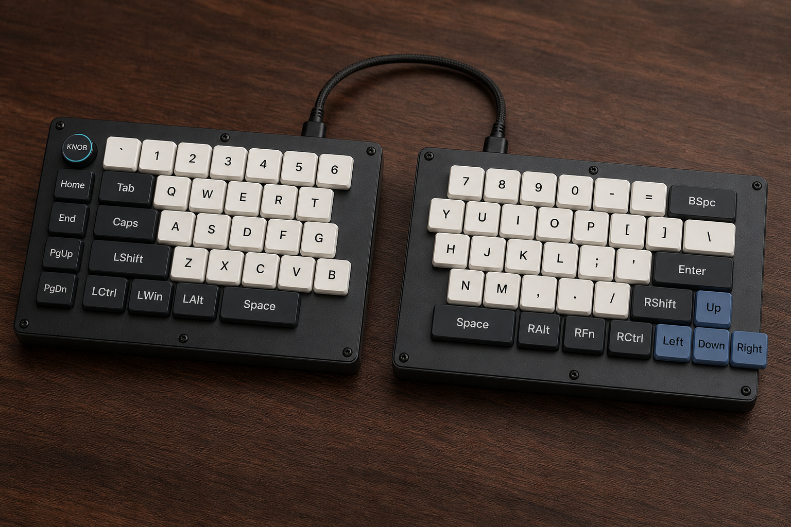

# choc-split-60 ⌨️

로우스태거(row‑staggered) 배열을 좌우로 나눈 **스플릿 키보드**입니다.
Kailh **Choc v1 로우프로파일 핫스왑** 스위치 **69개 + 로터리 인코더 1개 = 70키 포지션**
(좌 34 / 우 36), 좌우 각각 **RP2040 Pro Micro**, TRRS 4극 케이블 통신, `COL2ROW` 매트릭스를 씁니다.
모든 PCB 배선은 자동 라우터 없이 좌표를 계산해 직접 배선했고, `scripts/verify_pcb.py`로 전수 검증합니다.



*(실물 느낌 렌더 — 위 도면 그대로의 배열입니다)*


*(KLE 형식 도면 — 좌우 행 오프셋과 0.25u 매크로 열 간격이 그대로 보입니다)*


*(PCB 미리보기: 빨강 = F.Cu, 파랑 = B.Cu, 흰 점 = 비아, 회색 = F.Silkscreen)*

---

## 1. 보드 사양

| 항목 | 값 |
|---|---|
| 배열 | 65% 로우스태거 + 좌측 매크로 열 + 우측 방향키, 좌우 분리 |
| 키 수 | 좌 33 스위치 + 인코더 1 / 우 36 스위치 = **스위치 69 + 엔코더 1 (70 포지션)** |
| 키 피치 | 19.05 mm (MX 표준 피치, Choc v1 스위치/키캡 사용) |
| 행 스태거 | 좌 `0 / 0.5u / 0.75u / 1.25u` · 우 `0.5 / 0 / 0.25 / 0.75u` (ANSI 표준값, Tab 1.5u·Caps 1.75u·LShift 2.25u·`\` 1.5u) |
| 분할 위치 | 숫자열 `6`\|`7`, 알파열 `T`\|`Y`, `G`\|`H`, `B`\|`N` — 두 장을 이어 붙이면 실제 ANSI 배열이 됩니다 |
| 매크로 열 | 좌측 최외곽 열에서 **0.25u(4.7625 mm)** 띄워 배치, 위→아래 `노브 → Home → End → PgUp → PgDn` |
| 방향키 | 우측 하단 `↑`(Row 3) 위에 `← ↓ →`(Row 4), RShift 1.75u 뒤에 ↑ 배치 |
| 스위치 | Kailh Choc v1 (CPG1350), **핫스왑 소켓** (`SW_Hotswap_Kailh_Choc_V1`) |
| 인코더 | Alps EC11 / Bourns PEC11R 호환 5핀 (A·C·B + 푸시 스위치 2핀), 6 mm 축 |
| 다이오드 | 1N4148W SOD-123 × 70 (스위치 69 + 인코더 푸시 1), `COL2ROW` |
| MCU | RP2040 Pro Micro (Elite‑Pi / Pro Micro RP2040 호환, 24핀) × 2 |
| 좌우 연결 | TRRS PJ‑320A × 2, Full‑duplex UART (`VCC/GND/TX/RX`) |
| 리셋 | 6×6 택트 스위치 × 2 (RST–GND) |
| PCB | 2층, 1.6 mm, 좌 176×130 mm / 우 195×130 mm, M2 마운팅 홀 각 6개 |
| 펌웨어 | QMK + VIAL (RP2040, `MASTER_LEFT`, `ENCODER_MAP_ENABLE`) |

### 레이아웃

```
       ┌───┐
       │ENC│   ┌───┬───┬───┬───┬───┬───┬───┐
       ├───┤   │ ` │ 1 │ 2 │ 3 │ 4 │ 5 │ 6 │
       │Hom│   ├───┴─┬─┴─┬─┴─┬─┴─┬─┴─┬─┴─┬─┘
       ├───┤   │ Tab │ Q │ W │ E │ R │ T │
       │End│   ├─────┴┬──┴┬──┴┬──┴┬──┴┬──┘
       ├───┤   │ Caps │ A │ S │ D │ F │ G │
       │PgU│   ├──────┴┬──┴┬──┴┬──┴┬──┴┬──┘
       ├───┤   │ LShift│ Z │ X │ C │ V │ B │
       │PgD│   ├───┬───┼───┼──┬┴───┴───┘
       └───┘   │Ctl│Win│Alt│ Space │        ← 좌측 (34 포지션)
               └───┴───┴───┴───────┘
                ↑ 매크로 열과 본열 사이 간격 0.25u
```

우측 하프 (36 포지션). 각 행은 왼쪽 끝이 자기 오프셋에서 시작합니다 — x는 키 단위(u).

| 행 | 시작 x | 키 (왼쪽→오른쪽) | 오른쪽 끝 |
|---|---|---|---|
| Row 0 | **0.5u** | `7 8 9 0 - =` + `BSpc` 2.0u | 8.5u |
| Row 1 | **0.0u** | `Y U I O P [ ]` + `\` 1.5u | 8.5u |
| Row 2 | **0.25u** | `H J K L ; '` + `Enter` 2.25u | 8.5u |
| Row 3 | **0.75u** | `N M , . /` + `RShift` 1.75u + `Up` (x 7.5u) | 8.5u |
| Row 4 | **0.5u** | `Space` 2.25u + `RAlt`/`RFn`/`RCtrl` 1.25u×3 + `Left` (x 6.5u) + `Down` (x 7.5u) + `Right` (x 8.5u) | 9.5u |

Row 0~3은 오른쪽 끝이 모두 **8.5u**로 한 줄로 맞습니다. 하단 열만 방향키 `Right`가
**9.5u**까지 나가고, `Down`은 `Up`(7.5~8.5u) 바로 아래에 놓입니다.
좌측 하프의 행 오프셋(`0 / 0.5 / 0.75 / 1.25u`)과 합치면 두 장을 나란히 놓았을 때
실제 ANSI 로우스태거가 됩니다(숫자열 `6`|`7`, 알파열 `T`|`Y`, `G`|`H`, `B`|`N`).

키캡 구성: **1u × 54, 1.25u × 6, 1.5u × 2, 1.75u × 2, 2u × 2, 2.25u × 3** (총 69개) + 노브 1개

---

## 2. 매트릭스와 핀맵

양쪽 PCB 모두 **5행 × 8열** 매트릭스를 쓰고, MCU 핀 배치는 좌우가 완전히 동일합니다.
좌측 매크로 열은 **COL7** 을 쓰고, 인코더 푸시 스위치는 그 열의 Row 0(`L07`)에 들어갑니다.

### MCU 핀 → 네트 (좌/우 동일)

| 핀 | 이름 | 네트 | | 핀 | 이름 | 네트 |
|---|---|---|---|---|---|---|
| 1 | GP0 | `TX` | | 13 | RAW | – (미사용) |
| 2 | GP1 | `RX` | | 14 | GND | `GND` |
| 3 | GND | `GND` | | 15 | RST | `RST` (리셋 스위치) |
| 4 | GND | `GND` | | 16 | VCC | `VCC` (TRRS Tip) |
| 5 | GP2 | `ROW0` | | 17 | GP29 | `ENC_B` (좌측만) |
| 6 | GP3 | `ROW1` | | 18 | GP28 | `ENC_A` (좌측만) |
| 7 | GP4 | `ROW2` | | 19 | GP27 | – (예비) |
| 8 | GP5 | `ROW3` | | 20 | GP26 | `COL7` |
| 9 | GP6 | `ROW4` | | 21 | GP22 | `COL5` |
| 10 | GP7 | `COL0` | | 22 | GP20 | `COL3` |
| 11 | GP8 | `COL1` | | 23 | GP23 | `COL6` |
| 12 | GP9 | `COL2` | | 24 | GP21 | `COL4` |

> 열 순서를 한 줄로 정리하면 `COL0..COL7 = GP7, GP8, GP9, GP20, GP21, GP22, GP23, GP26` 입니다.
> 우측 PCB는 인코더가 없어서 GP28/GP29가 비어 있고, 그 핀은 풀업 입력으로만 남습니다.
> (GP27은 예비로 비워 두었습니다.)

### 키 → (행, 열)

| 행 \ 열 | 0 | 1 | 2 | 3 | 4 | 5 | 6 | 7 |
|---|---|---|---|---|---|---|---|---|
| L0 | 좌 `` ` `` | 1 | 2 | 3 | 4 | 5 | 6 | 좌 ENC |
| L1 | 좌 Tab | Q | W | E | R | T | – | 좌 Home |
| L2 | 좌 Caps | A | S | D | F | G | – | 좌 End |
| L3 | 좌 LShift | Z | X | C | V | B | – | 좌 PgUp |
| L4 | 좌 LCtrl | LWin | LAlt | 좌 Space | – | – | – | 좌 PgDn |
| R0 | 우 7 | 8 | 9 | 0 | - | = | BSpc | – |
| R1 | Y | U | I | O | P | [ | ] | \ |
| R2 | H | J | K | L | ; | ' | Enter | – |
| R3 | N | M | , | . | / | RShift | ↑ | – |
| R4 | 우 Space | RAlt | RFn | RCtrl | ← | ↓ | → | – |

* QMK `MATRIX_ROWS = 10` (좌 0–4 / 우 5–9), `MATRIX_COLS = 8`.
* 인코더 A/B는 매트릭스가 아니라 **GP28 / GP29** 직결이고, 푸시 스위치만 매트릭스 `L07`에 들어갑니다.

### TRRS 배선 (좌우가 서로 반대)

| TRRS | 좌측 PCB | 우측 PCB |
|---|---|---|
| Tip | `VCC` | `VCC` |
| Ring1 | `GND` | `GND` |
| Ring2 | `TX` (GP0) | `RX` (GP1) |
| Sleeve | `RX` (GP1) | `TX` (GP0) |

> 좌측이 항상 마스터입니다(`MASTER_LEFT`). USB‑C 케이블은 **좌측**에 꽂으세요.

---

## 3. 배선 설계 규칙 (자동 라우터 미사용)

* 행(Row) 버스는 **F.Cu에 가로**로, 열(Col)은 **B.Cu에 세로**로 배선하고, 두 방향이 교차하는 지점은
  비아로 층을 바꿔 같은 층 쇼트를 만들지 않습니다.
* 신호선 **0.25 mm**, 전원(VCC/GND) **0.5 mm**, 비아 **0.6 / 0.3 mm(드릴)**.
* 동일 층 타 네트 교차 0건, 최소 클리어런스 **0.2 mm**, 보드 외곽 이격 **0.3 mm**.
* 모든 트랙은 0/45/90도. 스위치 홀·핫스왑 패드·마운팅 홀·TRRS/리셋/인코더 패드를 장애물로 계산해 회피.
* 매크로 열 스위치도 나머지 키와 같은 트러스(스위치 → 다이오드 → 비아 → 행 버스)를 그대로 씁니다.
  인코더 푸시 스위치는 `S2 → D_ENC → ROW0` 로 짧게 90도 두 마디로 연결합니다.
* 양면 **GND 존**(F.Cu, B.Cu) + GND는 별도 트랙으로도 전부 연결(존 필 없이도 통전).
* `Edge.Cuts`는 폐곡선(4개 선분)으로 마감, 키·부품과 0.3 mm 이상 이격.

---

## 4. 검증 결과

`scripts/verify_pcb.py`가 생성된 `.kicad_pcb` 파일을 **독립적으로 파싱**해 다음을 전수 검사합니다.

1. 모든 신호 네트 100% 연결(미연결 패드 0건)
2. 동일 층 타 네트 클리어런스 위반 0건 (정확한 폴리곤–세그먼트 거리 계산)
3. 스위치–다이오드 1:1 매칭, 극성(캐소드→행, 애노드→스위치) 일치
4. `Edge.Cuts` 폐곡선 및 외곽 이격
5. 트랙 0/45/90도, 최소 폭, GND 존 존재

```
$ python3 scripts/verify_pcb.py
======================================================================
checking choc-split-60-left.kicad_pcb
  pads=171 tracks=222 vias=39 nets=55
  OK: all checks passed
======================================================================
checking choc-split-60-right.kicad_pcb
  pads=176 tracks=246 vias=54 nets=55
  OK: all checks passed
```

> KiCad DRC가 아니라 자체 기하 검증입니다. 계산 근거는 `scripts/verify_pcb.py`에 그대로 들어 있습니다.
> KiCad에서 열어 `Inspect → Design Rules Checker`를 한 번 더 돌리는 것을 권장합니다.

---

## 5. BOM

| # | 수량 | 부품 | 비고 |
|---|---|---|---|
| 1 | 2 | RP2040 Pro Micro (Elite‑Pi 등) | 24핀 2.54 mm, **핀 소켓** 사용 권장 |
| 2 | 69 | Kailh Choc v1 (CPG1350) 스위치 | 로우프로파일 |
| 3 | 69 | Choc 핫스왑 소켓 | PCB 뒷면 |
| 4 | 70 | 1N4148W (SOD‑123) | 캐소드(띠) 방향 주의 (D_ENC 포함) |
| 5 | 1 | Alps EC11 / Bourns PEC11R 인코더 (푸시 포함) | 6 mm 축, 너트/와셔 포함품 |
| 6 | 1 | 6 mm D컷 노브 | 인코더 축용 |
| 7 | 2 | TRRS 잭 PJ‑320A | 3.5 mm 4극 |
| 8 | 2 | 6×6×5 mm 택트 스위치 | 리셋 |
| 9 | 12 | M2 나사/너트 | 홀 2.2 mm, 보드당 6개 |
| 10 | 69 | Choc 키캡 | 1u 54 / 1.25u 6 / 1.5u 2 / 1.75u 2 / 2u 2 / 2.25u 3 |
| 11 | 5 | Choc **플레이트 마운트** 스태빌라이저 | 2u·2.25u 키용 (PCB 홀 없음) |
| 12 | 2 | PCB (2층, 1.6 mm) | 좌 176×130 / 우 195×130 mm |

배선 통계(검증 스크립트 기준)

| | 좌 | 우 |
|---|---|---|
| 트랙 | 222 세그먼트 / 약 3.11 m | 278 세그먼트 / 약 3.46 m |
| 비아 (0.6/0.3 mm) | 39 | 48 |
| 네트 | 55 | 55 |

기계 파일(`BOM.csv`)도 함께 들어 있습니다.

---

## 6. JLCPCB 발주 가이드

1. Gerber: KiCad에서 각 `.kicad_pcb`를 열고 `File → Fabrication Outputs → Gerbers`로 생성
   (2 layer, F.Cu/B.Cu + F.Mask/B.Mask + F.Silkscreen/B.Silkscreen + Edge.Cuts + 드릴 파일).
2. 두 보드는 **서로 다른 PCB**입니다. `choc-split-60-left`, `choc-split-60-right`를 각각 주문하거나,
   같은 주문에 두 파일을 넣을 경우 **패널라이징(별도 PCB로 2종 주문)** 하는 편이 안전합니다.
3. 권장 옵션
   * Layers: 2, Thickness: 1.6 mm, FR‑4
   * Min track/spacing: 0.25 mm / 0.2 mm (본 설계 최소값)
   * Min hole: 0.3 mm (비아 0.3 mm 드릴 사용)
   * Surface finish: HASL (무연)
   * Gold fingers / impedance / castellation: 없음
   * SMT 조립은 하지 않습니다(전 부품 수동 납땜).
4. 주문 전 KiCad 3D 뷰어로 **스위치·MCU·TRRS·인코더 간섭**을 한 번 확인하세요.
   특히 인코더는 보디가 12.4 mm라 1u 자리에 들어가지만, 노브가 키캡보다 높으므로
   케이스 상판을 만들 때 **노브 자리 홀**을 따로 뚫어야 합니다.

---

## 7. 조립

1. **뒷면(B.Cu)** 에 Choc 핫스왑 소켓 69개와 SOD‑123 다이오드 70개를 납땜합니다.
   다이오드의 **캐소드 띠가 비아(행 버스) 쪽**을 향합니다.
2. 앞면에 MCU 핀 소켓(2×12)을 납땜하고 RP2040 Pro Micro를 꽂습니다.
   **USB‑C 커넥터가 보드 바깥쪽 가장자리**를 향하도록 넣으세요(좌: 왼쪽, 우: 오른쪽).
3. TRRS 잭과 리셋 택트 스위치를 납땜합니다.
4. **좌측** 매크로 열 맨 위에 EC11 인코더를 꽂아 납땜하고, 너트로 고정한 뒤 노브를 끼웁니다.
   핀 배열은 위에서부터 `A – C – B`(2.5 mm 피치), 반대쪽이 푸시 스위치 `S1 / S2` 입니다.
   > 사용하는 인코더가 PEC11R 계열이 아니면 **핀 피치(2.5 mm)와 마운트 포스트 지름(2.1 mm)** 을
   > 데이터시트로 한 번 확인하세요. 풋프린트는 `libs/choc60.pretty/RotaryEncoder_EC11.kicad_mod`.
5. 스위치를 핫스왑 소켓에 꽂고, 보강판(플레이트)과 케이스를 조립합니다.
   2u/2.25u 키에는 **플레이트 마운트 Choc 스태빌라이저**를 사용합니다(PCB에는 홀 없음).
6. TRRS 케이블로 좌우를 연결하고, USB를 **좌측**에 연결합니다.

> **보강판/케이스**: 본 리포에는 케이스·보강판 도면이 없습니다. Choc 표준 컷아웃
> (14×14 mm 스위치 홀, 19.05 mm 피치, 1.6 mm 판재)으로 별도 제작하면 됩니다.
> 매크로 열은 본열과 0.25u(4.76 mm) 떨어져 있으니 컷아웃 사이에 4.76 mm 리브가 남습니다.

> MCU를 납땜으로 PCB에 바로 붙이면 아래쪽 배선과 붙을 수 있습니다. 반드시 **핀 소켓**을 쓰세요.

---

## 8. 펌웨어 (QMK / VIAL)

```
firmware/choc_split_60/
├── choc_split_60.h      # LAYOUT 매크로 (70 포지션)
├── config.h             # 매트릭스 핀(5x8), COL2ROW, 시리얼, MASTER_LEFT, ENCODERS_PAD
├── info.json            # QMK 메타데이터(핀, 레이아웃, split, encoder) - 스크립트로 생성
├── rules.mk             # SPLIT_KEYBOARD, SERIAL_DRIVER=vendor, ENCODER_ENABLE/ENCODER_MAP_ENABLE
└── keymaps/
    ├── default/keymap.c
    └── vial/{keymap.c, vial.json, config.h}
```

* `info.json`, `vial.json`은 `scripts/gen_firmware.py`가 **PCB 레이아웃에서 그대로 생성**합니다.
  배열을 바꾸려면 `scripts/pcbgen/layout.py`만 고치고 두 스크립트를 다시 돌리면 됩니다.
* 인코더는 좌측에만 있고, 푸시 스위치는 매트릭스 `L07`(기본 레이어 `KC_MUTE`)입니다.
* 엔코더 맵(레이어별 시계/반시계):
  * `_BASE`: 볼륨 다운 / 업
  * `_FN`: Page Down / Page Up
  * `_NAV`: 이전 곡 / 다음 곡

### QMK

```bash
git clone https://github.com/qmk/qmk_firmware
cp -r firmware/choc_split_60 qmk_firmware/keyboards/
cd qmk_firmware
qmk compile -kb choc_split_60 -km default
# 생성된 choc_split_60_default.uf2 를 RPI-RP2 드라이브에 복사
```

### VIAL

```bash
git clone https://github.com/vial-kb/vial-qmk
cp -r firmware/choc_split_60 vial-qmk/keyboards/
cd vial-qmk
make choc_split_60:vial
```

부트로더 진입: 리셋 스위치를 **두 번** 누르거나, 부팅 중 BOOT를 누른 상태로 USB 연결.

---

## 9. 리포지터리 구조

```
pcb/      choc-split-60-{left,right}.kicad_{pro,sch,pcb} + fp-lib-table
libs/     choc60.pretty (Choc 핫스왑, SOD-123, Pro Micro RP2040, TRRS, 택트, EC11, M2)
scripts/  generate_pcb.py (설계·배선 생성), verify_pcb.py (검증), preview.py,
          gen_firmware.py (info.json/vial.json 생성), layout_kle.py (KLE 도면),
          export_libs.py
docs/     preview-*.png, layout-kle.png, layout-render.png, verification.txt
firmware/ QMK/VIAL 키보드 정의
BOM.csv, LICENSE
```

### 다시 생성하기

```bash
python3 scripts/generate_pcb.py    # 두 장의 PCB + 회로도 + 프로젝트 파일 재생성
python3 scripts/gen_firmware.py    # info.json / vial.json 재생성
python3 scripts/export_libs.py     # libs/choc60.pretty 갱신
python3 scripts/verify_pcb.py      # 기하 검증(위 4장의 결과가 다시 나옵니다)
python3 scripts/preview.py         # 미리보기 PNG (좌/우)
python3 scripts/layout_kle.py      # KLE 형식 도면 PNG (layout.py 좌표에서 직접)
```

`generate_pcb.py`는 KiCad 파일을 직접 쓰고, 배선은 자체 A* 라우터(0.25 mm 그리드, 45도 이동,
비아 0.6/0.3)로 계산합니다. FreeRouting 등 외부 자동 라우터는 사용하지 않습니다.

---

## 10. 변경 이력

**2026-11-24 (2) 우측 행 스태거 수정**
* 우측 PCB의 다섯 행이 전부 `x = 0`에서 시작해 **일직선(오쏘리니어처럼)** 보이던 문제를 고쳐
  표준 ANSI **로우스태거**를 넣었습니다. 오프셋은 `0.5 / 0 / 0.25 / 0.75u`,
  분할선은 숫자열 `6`|`7`, `T`|`Y`, `G`|`H`, `B`|`N`입니다.
* Row 0~3의 오른쪽 끝을 전부 **8.5u**로 맞췄습니다. 그래서 `\` 는 1u → **1.5u**
  (좌측 Tab과 같은 규격)로 넓혔습니다.
* 하단 열은 `Space 2.25u + RAlt/RFn/RCtrl 1.25u×3` 으로 정확히 **6.5u**에서 끝나고,
  그 뒤로 `← 6.5 / ↓ 7.5 / → 8.5~9.5u` 가 붙습니다. `↓`는 `↑`(7.5~8.5u) 바로 아래입니다.
* 보드 폭을 **182 → 195 mm** 로 늘려 `→` 키가 외곽선 밖으로 나가지 않게 했고, 마운팅 홀도 다시 배치했습니다.
* `docs/layout-kle.png`(KLE 도면)와 `docs/layout-render.png`(실물 렌더)를 새로 넣고 README에 올렸습니다.

**2026-11-24 (1)**
* 스페이스바 아래에 돌출돼 있던 **Th1/Th2 썸키 4개를 제거**하고, 보드를 그만큼 줄였습니다
  (좌 160×143 → 176×130 mm, 우 175×143 → 182×130 mm).
* 좌측 최외곽 열에서 **0.25u 왼쪽**에 1u 폭 세로 열을 새로 만들고 위에서부터
  **로터리 인코더 · Home · End · Page Up · Page Down** 을 넣었습니다.
* 우측 하단에 **방향키 `← ↓ →` + 그 위의 `↑`** 를 넣었습니다(RShift는 1.75u 유지).
* 매트릭스를 **6행×8열 → 5행×8열**(좌우 합 10×8)로 정리하고, 열을 하나 늘리지 않기 위해
  매크로 열은 비어 있던 좌측 `COL7`에 배정했습니다.
* 여유 GPIO가 정확히 2개 남아 **GP28/GP29를 인코더 A/B**에 배정했습니다(더미 핀 없음).

**2026-11-23** 65키 로우스태거 스플릿 초판.

---

## 11. 크레딧

* Choc v1 / 핫스왑 풋프린트 형상: [keyswitch-kicad-library](https://github.com/perigoso/keyswitch-kicad-library) (CC‑BY‑SA‑4.0)
* TRRS PJ‑320A 풋프린트: [Keebio‑Parts](https://github.com/keebio/Keebio-Parts.pretty)
* EC11 인코더 패드 좌표: Bourns PEC11R 데이터시트 (A–C–B 2.5 mm 피치, 마운트 2.1 mm)
* QMK / VIAL 펌웨어

라이선스: **CC BY‑SA 4.0** (`LICENSE` 참고)
